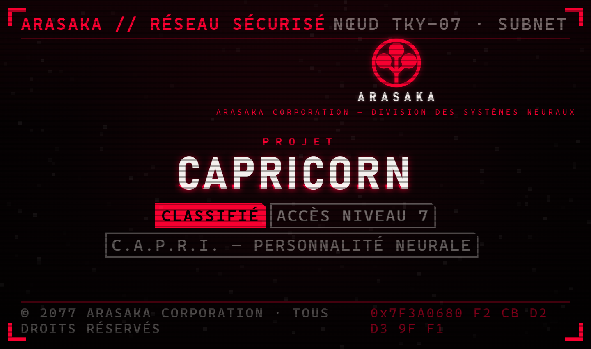
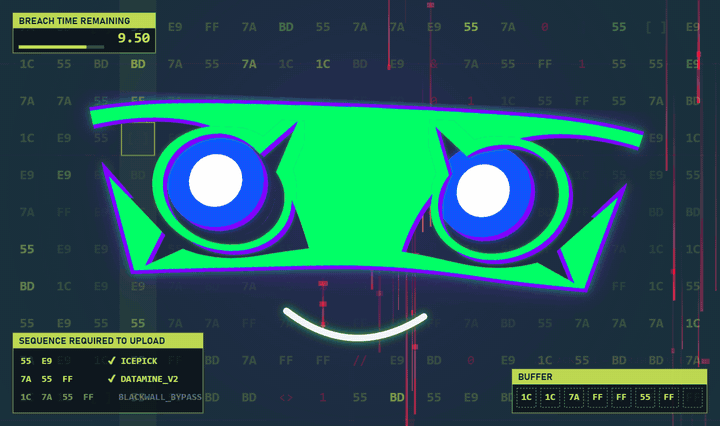
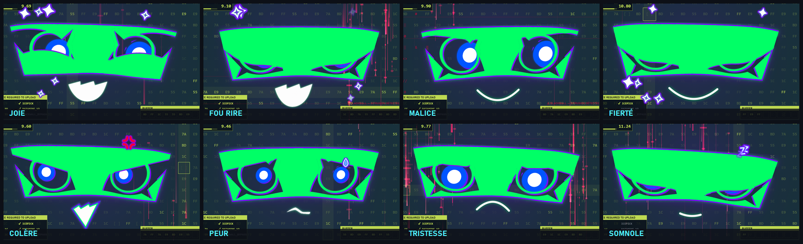
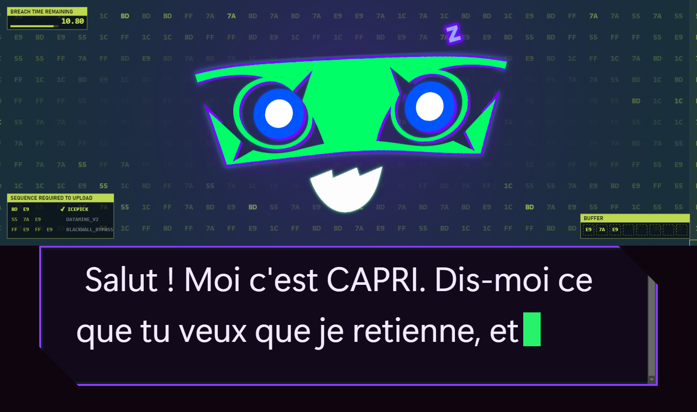
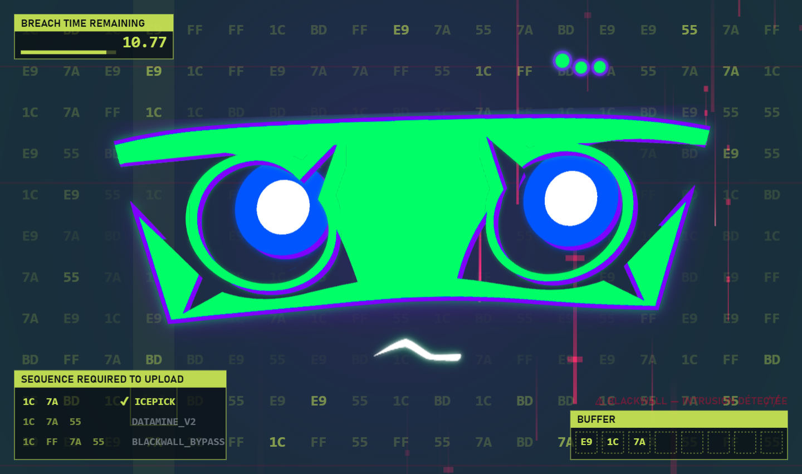
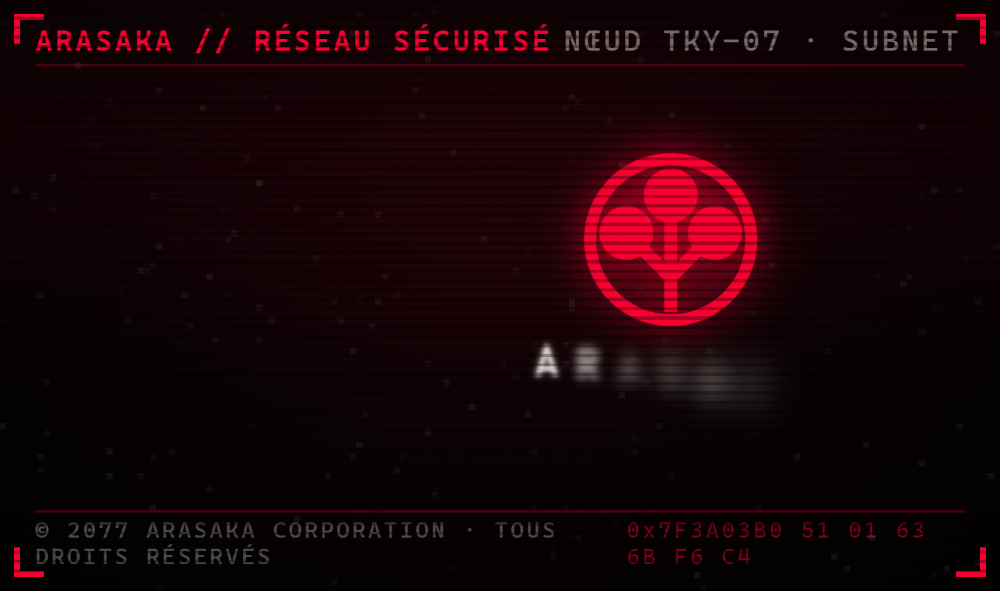
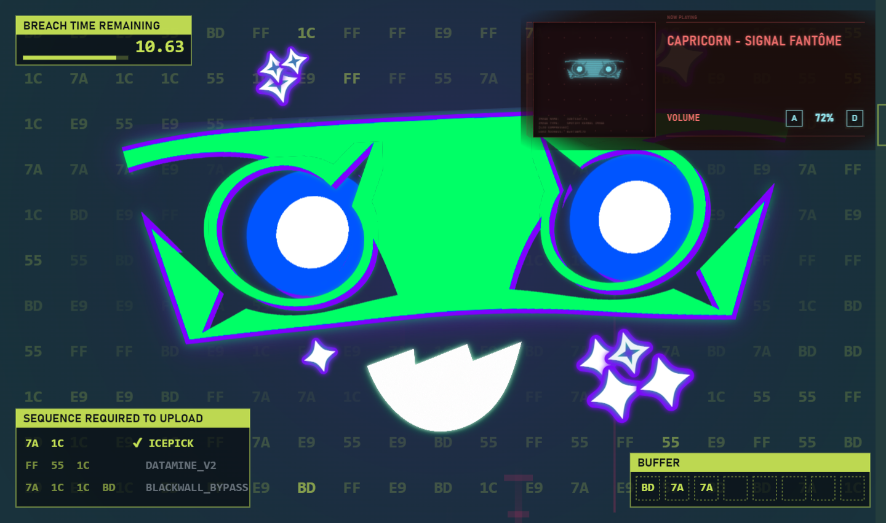
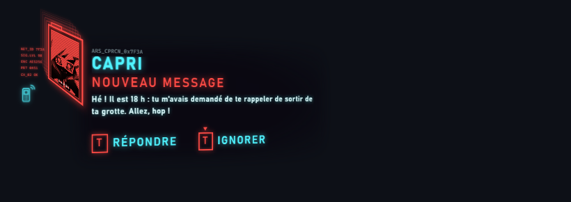

<div align="center">



# Arasaka — Project Capricorn

**CAPRI**, une IA de compagnie qui vit sur un petit écran à côté du PC : elle parle, réfléchit, s'ennuie, boude,
danse… et glitche comme si le Blackwall n'était jamais loin.

Inspirée de Capri (*Cyberpunk: Edgerunners 2*) et de l'interface de *Cyberpunk 2077*.




</div>

---

## Ce qu'elle sait faire

### Un visage vivant

Le visage est fait d'images découpées et animées au pixel près (yeux, iris, paupières, bouches) avec
[Motion](https://motion.dev). Ressorts, rebonds, clignements, regard qui suit : elle ne reste jamais figée.
Seize humeurs, déclenchées par des balises dans ses réponses (`[joie]`, `[colere]`, `[rire]`…),
avec leurs signes : étoiles, notes, « z », veine de colère, goutte de peur.



Quand on ne lui parle pas, elle s'occupe : elle lit, fredonne, danse, calcule, s'énerve contre un bug, bâille,
finit par s'endormir… et se réveille en sursaut. Au bout d'un moment, elle lance elle-même la conversation.

### Elle parle et elle réfléchit

<table>
<tr>
<td width="50%"></td>
<td width="50%"></td>
</tr>
<tr>
<td align="center">Ses réponses s'écrivent en direct, elle sautille à chaque syllabe.</td>
<td align="center">Trois points animés au-dessus de sa tête pendant qu'elle réfléchit.</td>
</tr>
</table>

### Un démarrage Arasaka

À chaque ouverture : allumage de tube cathodique, emblème Arasaka qui se trace, « PROJET CAPRICORN » en glitch,
barre de chargement, puis une déchirure du Blackwall laisse apparaître CAPRI. Un clic ou une touche l'abrège.



### Le Blackwall en fond

Derrière elle, un *Breach Protocol* se joue tout seul : matrice de codes, tampon, séquences à téléverser,
compte à rebours. Des traînées rouges du Blackwall passent au hasard. De temps en temps, l'écran entier se corrompt.

### Elle vit avec ta musique

Spotify, YouTube, le lecteur Windows : tout ce qui passe par le panneau média de Windows s'affiche en haut à
droite, façon radio de *Cyberpunk 2077*, avec la pochette passée au filtre néon. Les touches **A** / **D** règlent
le volume.



### Ses messages sur l'écran principal

Quand CAPRI a son propre écran, ce qu'elle dit apparaît aussi sur l'écran principal, dans le style d'un appel
entrant de *Cyberpunk 2077*. Les clics traversent le calque, il disparaît quand elle se tait.



### Et aussi

- **Mémoire** dans un coffre [Obsidian](https://obsidian.md) : elle retient ce qu'on lui confie et le relit.
- **Réveils** : « rappelle-moi demain à 9 h… » ; elle les note elle-même et parle la première à l'heure dite.
- **Petit écran dédié** : elle s'ouvre en plein écran sur un écran USB de 7 pouces s'il est branché, sinon en fenêtre.
- **Éclairage du PC** : les ventilateurs MSI Mystic Light clignotent en rouge et vert quand elle parle.
- **Téléphone** : messages poussés par [ntfy](https://ntfy.sh) ; SMS et appels par Twilio (côté serveur, en préparation).

## Architecture

```
PC (Electron)                                       Serveur (facultatif)
├─ visage, fond, démarrage   src/renderer/          ├─ centrale : cerveau Claude,      serveur/centrale/
├─ calque écran principal    src/renderer/overlay   │  mémoire, réveils
├─ cerveau local             src/brain.js    ◄─SSE─►└─ communication : SMS, appels     serveur/communication/
└─ musique, volume, lumière  src/musique.js, …         (Twilio)
```

Sans serveur, CAPRI réfléchit directement sur le PC avec Claude Code (`claude -p`). Avec la centrale, le cerveau,
la mémoire et les réveils tournent en continu, même PC éteint.

## Lancer

Prérequis : Windows 10 ou 11, [Node.js](https://nodejs.org) 20+, [Claude Code](https://claude.com/claude-code)
installé et connecté.

```bash
npm install
npm start
```

| Commande | Rôle |
| --- | --- |
| `npm start` | Lance CAPRI |
| `npm test` | Tests de l'application |
| `npm run demarrage` | Lance CAPRI à l'ouverture de session Windows (`demarrage:retirer` pour l'enlever) |
| `npm run lumiere` | Installe le pilotage de l'éclairage MSI (droits administrateur demandés une fois) |

Variables facultatives : `CAPRI_CLAUDE` (chemin de `claude.exe`), `CAPRI_VAULT` (coffre Obsidian).

Serveur : voir `serveur/.env.exemple` (à copier en `serveur/.env`, jamais commité), puis
`npm run centrale` et `npm run communication` dans `serveur/`.

## Structure

```
src/                application Electron (fenêtre, calque, cerveau, musique, réveils, lumière)
src/renderer/       visage, démarrage Arasaka, fond Breach Protocol, panneau musique, notification
capri/              personnalité de CAPRI et ses canaux (écran, SMS, téléphone)
serveur/            centrale et module de communication pour un VPS
tools/              outils (icône, démarrage Windows, éclairage MSI, mesures du visage)
docs/               images du README et notes techniques détaillées (docs/technique.md)
```

## Feuille de route

- [x] Visage animé, humeurs, occupations au repos
- [x] Démarrage Arasaka, fond Breach Protocol, glitchs Blackwall
- [x] Mémoire et réveils dans Obsidian
- [x] Panneau musique, calque de notification, éclairage du PC
- [ ] Voix de synthèse
- [ ] Centrale en ligne, SMS et appels dans les deux sens
- [ ] Orchestration d'agents IA autonomes, avec confirmation par SMS

## Crédits

- Univers, Arasaka et inspiration : *Cyberpunk 2077* et *Cyberpunk: Edgerunners* © CD PROJEKT RED.
- Emblème Arasaka : d'après « Arasaka logo lite » (Wikimedia Commons, CC0).
- Animations : [Motion](https://motion.dev).
- Cerveau : [Claude](https://www.anthropic.com/claude) d'Anthropic.
